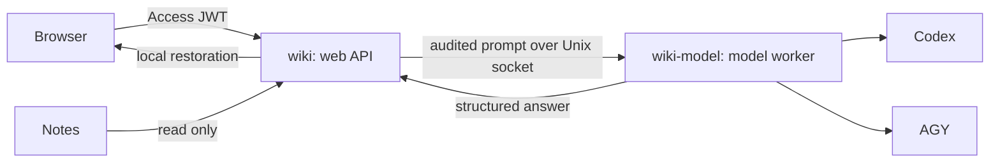

# Isolated Codex / AGY deployment

The recommended deployment has two Linux identities. `wiki` reads the notebook,
authenticates HTTP requests, redacts private values, and restores approved values.
`wiki-model` runs model clients and owns their credentials. It cannot read the
notebook, the web process's memory, or its old authentication profile.

## Layout and permissions

Install root-owned backend files at `/opt/wiki/app`, a complete Codex native bundle
at `/opt/wiki/codex`, and AGY at `/opt/wiki/agy/agy`. Use the versions you have tested;
the worker does not install or update CLIs. Python dependencies belong in the Python
environment used by the web service (adjust its interpreter path when using a venv).

Create locked `nologin` service accounts named `wiki` and `wiki-model`. Their private
credential directories must be owned by the corresponding account with mode `0700`.
Create `/var/lib/wiki-model` as root:wiki-model, mode `0750`, and its `codex` and
`agy` children as wiki-model:wiki-model, mode `0700`. The model user can update its
credentials but cannot replace these top-level provider directories.
The web service receives the `wiki-model` supplementary group only to connect to
the socket; this group must not grant access to credentials. The worker's runtime
directory is `0750` and its socket is `0660`.

Copy `config.worker.example.json` to `/etc/wiki/config.json` (root:wiki, `0640`) and
`model-worker.example.json` to `/etc/wiki-model/config.json` (root:wiki-model, `0640`).
Keep their parent directories restricted. Fill in real values outside the checkout.
Remove a provider from the worker configuration if it is not installed/authenticated.

Adapt the two system service examples. Every original notebook location and alias
must be unavailable inside the worker. The example hides all of `/srv`, `/home`,
and `/root`; add other notebook sources and other services' private directories
to `InaccessiblePaths`. Do not grant either service the Docker group or socket.

Authenticate each provider using a separate profile owned by `wiki-model`, without
copying your personal CLI settings or history. For Codex, `CODEX_HOME` is
`/var/lib/wiki-model/codex`. For AGY, `HOME` is `/var/lib/wiki-model/agy`. AGY 1.3.2
uses `.gemini/antigravity-cli/antigravity-oauth-token`; credential storage must be
rechecked when upgrading AGY. This integration currently supports AGY's account
login, not API-key authentication or a desktop keyring-only login.

## Request and retention boundary

Only the web API can access the raw notebook and placeholder-to-value mapping.
Only an audited `PreparedPrompt` is transmitted. Worker requests contain a version,
configured provider name, fixed purpose (`select` or `answer`), prompt, and deadline.
They cannot specify executable paths, arguments, credentials, environment variables,
or arbitrary output schemas. Both sides verify Unix peer identity.

Codex uses a reusable stdio app-server (tested with 0.162.0), with a fresh ephemeral
thread for every selection or answer call. Its empty temporary workspace and HOME
carry only allowlisted login files. Credential refreshes are saved after each call.
No personal configuration, plugins, rules, MCP settings or conversation history are
copied. Threads are unsubscribed after completion; the process and temporary HOME
are recycled after 32 calls, 30 minutes of age, or 5 idle minutes. This bounds the
app-server's in-memory unsubscribe grace period. AGY still uses a fresh process and
temporary HOME per call. Temporary artifacts are removed when each runtime closes.
Stderr is discarded and stdout is bounded. Codex tool-disabling flags and AGY deny
rules add a second restriction to the OS boundary. AGY slash/skill expansion is
disabled. A reported AGY tool operation makes the answer fail closed.

The worker admits one model invocation, enforces a deadline, and stops the process
group on cancellation, caller disconnect or output overflow. Codex stays alive after
successful calls; AGY exits on completion. Linux subreaping
also collects detached helpers. Output must satisfy the same application contract
for both providers; source and private-placeholder validation still happens in the
web API. Failures never cause an automatic retry or switch to another provider.

The worker records a fixed provider, purpose (`select` or `answer`), status,
error code and elapsed milliseconds in the service journal. Successful Codex calls
also record process reuse, startup time and first text-delta time. Prompts, note names,
answers, credentials and CLI diagnostics are excluded. The client maps known error
codes to fixed messages so timeouts, invalid output and tool attempts can be
distinguished without exposing provider output.

Protocol version 2 carries bounded previews followed by one validated result.
Upgrade web and worker modules together. The web API strips opaque private tokens
from previews and sends authenticated, owner-scoped NDJSON over renewable 20-second
GETs. Only the final validated result includes restored values and citations. The
browser renders previews as literal text and removes them on failure/cancellation.
Reconnecting observes the existing job and never starts another model request.
Use `proxy_buffering off` and a proxy read timeout above 20 seconds. At most four
streams are served at once; slow writers time out after two seconds.

For deployment, test activity by taking a nonblocking exclusive lock on
`activity.lock` beside the worker socket; idle app-server children are expected.
Hold that lock through stopping the services. Restart both services after a protocol
upgrade. Service SIGTERM cancels active work and cleans the temporary model runtime.

Temporary profiles reduce local retention; they are not a promise of remote
zero-retention, secure disk erasure, or perfect automatic secret detection. Ordinary
note content still goes to the selected model provider. See `PRIVACY.md`.

## Select a provider

Set `ai.provider` in the private web configuration to `codex` or `agy` and restart
the web service. Configure each model and effort in the private worker configuration;
restart the worker after editing it. Provider selection is controlled by the operator,
not an HTTP request. Keep the current provider selected until a synthetic end-to-end
request succeeds through the new provider and the worker's note-access denial is verified.
The web service stays available during a worker restart; a request interrupted by
that restart fails without being replayed. `/health` only checks the web process.

The existing `config.example.json` and user service remain available for older,
direct Codex-only installations. AGY always uses the isolated worker path.

## Verification

Confirm actual UIDs, read-only notes in the web service, inaccessible note sources
in the worker, and inaccessible AI credentials in the web service. Check HTTP 401
without authentication and public Access redirects. Then issue a synthetic request
through each enabled provider, confirm cancellation cleanup, and confirm that only
credential files persist. CLI `--help` checks alone do not prove login, model access,
structured-output behavior or sandbox enforcement.
Use a fictional notebook question that exercises both document selection and
answer generation, including a masked value and its local restoration. A simple
"reply OK" probe proves connectivity but does not test retrieval or citations.

References: [AGY headless mode](https://antigravity.google/docs/cli/headless/),
[AGY permissions](https://antigravity.google/docs/permissions/),
[Codex CLI reference](https://learn.chatgpt.com/docs/cli/reference).
The streaming integration follows the [Codex app-server protocol](https://learn.chatgpt.com/docs/app-server).
